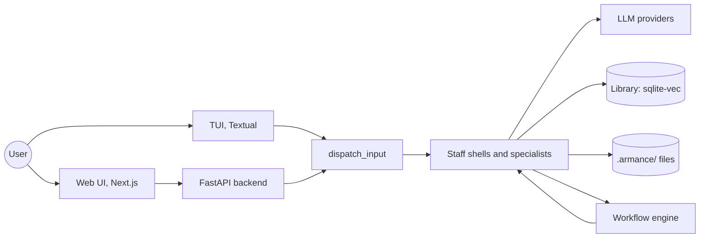

# Architecture

How Armance is built, in what does not change often. File layouts, schemas and counts live in the code: the
canonical paths of a project are in `src/armance/storage/paths.py`, each module's intent in [modules/](modules/).

## System



One Python package, run on the user's machine. `armance run` opens the TUI; `armance web` serves the API and the
static web bundle in one process; `armance` alone opens the launcher (projects list). No server to deploy, no
database for state.

What is hard here: keeping a panel of LLMs honest. Models agree too easily (Serge, cross-family), state facts they
cannot source (claims ledger, dated RAG), and hide their cost (footprint ledger). Most of the code that is not
plumbing serves one of these three.

## Layers

`client -> transport -> service -> core`, lower never imports upper ([decision 4](decisions.md)). `client` renders and
reads input, `transport` is DTOs and the event bus, `service` orchestrates agents, workflows and the library, `core`
holds pure models and the `LLMClient` protocol. Concrete clients live in `providers/` and register into `core` at
import. `platform/` gives the web layer its sessions, events and storage seams. CI enforces the rule with import-linter
(`.importlinter`) and `scripts/check_invariants.sh`.

## Where state lives

- Global directory (platformdirs, `~/.config/armance` on Linux, `ARMANCE_CONFIG_DIR` to override): `config.yaml`,
  `.env` with the API keys, base agents, the project registry, user preset packs. One setup per machine.
- Project directory `<folder>/.armance/`: data only. Documents, recruited agents (one Markdown file each: frontmatter
  is the contract, body is the system prompt), workflows, runs (versioned, never overwritten, with a `manifest.json`),
  context layers, reports, sessions, the RAG index. Deleting it forgets the project.

Write under `.armance/` only through the `storage/` helpers: the shape is a contract with the user.

## A turn

```
client input
  -> service/tui_bridge.dispatch_input
       slash command   -> service/handlers (HANDLERS)
       "@Name, ..."    -> switch agent, then dispatch
       free text       -> the current staff shell or specialist (service/chat_handlers/)
  -> service/agents/*: system prompt = agent body + compression protocol + voice overlay
                                      + RAG section + project brief + team roster (+ L0/L1/L2 for specialists)
  -> service/llm_service.call_with_ledger: LLM call, tokens, cost, footprint
  -> reply scrubbed by service/agent_sandbox, then [EXECUTE:/...] tags intercepted
```

Side effects only come from tags, checked against the role's allowlist ([decision 5](decisions.md)). Only Mona and the
specialists engage with project content: Armance frames, Malik recruits, Kim orchestrates, and their prompts refuse to
propose answers. A question to the human from the service layer always goes through a `CheckpointHandler`, the same
for the TUI and the web.

Prompts are compressed by protocol (`src/armance/protocols/caveman_*.txt`): worker specialists get `ultra`,
user-facing staff gets `none`. The claude-code SDK runs hermetic, so the host's Claude Code plugins and hooks never
reach an Armance agent.

## Library

Two states that users and agents must not confuse:

- indexed: the document is chunked into slips and embedded, so passages can be retrieved by similarity, but no agent
  has read it;
- loaded (read): its full text goes into every agent's context, persistently or for the session.

Indexing only happens on request (`/library index` or Armance's tag), never at boot: an early silent fallback to zero
vectors once made Armance claim documents it had never read. A retrieved chunk is injected with its source; rerank
is an optional second stage. User vocabulary: library, slip, index, load (bibliothèque, feuillet, indexer, charger).

## Workflows

Kim designs a workflow in four phases (goal, shape and roles, design dialogue, run then hand-off to Mona) and writes
it as YAML. `execute_workflow` runs it by topological level, steps of a level in parallel, `human_checkpoint` steps
through the checkpoint handler ([decision 7](decisions.md)). Hooks from the service layer add the cross-family warning
and Serge's auto-invoke on soft consensus.

The Creuset is the quality subgraph for a hard step: two or more drafts on distinct model families, a comparative
critique on a third, a synthesis, a gate on another family scoring a rubric and emitting `[GATE:ACCEPT]` or
`[GATE:REVISE]`, and one revision unrolled statically behind `run_if`. Its run writes `quality.md`; a single-family
setup degrades with a notice, never a fault. `/workflow rerun --override-step` replays a run from a hand-edited step
into a new run marked `derived_from`.

## Providers and families

Four provider types (`openrouter`, `claude-code`, `gemini`, `custom-openai`), each usable as named instances with a
model allowlist ([decision 8](decisions.md)). Each agent is a `(provider, model, reasoning effort)` triple in its
frontmatter, and Malik mixes providers in a panel. A model family is the provider type; `model_family` in
`service/workflow_crucible.py` is the one place that resolves it, for Serge, the Creuset and Malik's roster.

## Web layer

A transport adapter, not a second application: FastAPI routes under `/projects/{pid}/sessions/{sid}/...`, an SSE
event stream, and a Next.js frontend exported as a static bundle into the wheel. One owner secret gates every data
route, on both mounts (`""` and `/api`). Single writer: LAN clients only watch ([decision 1](decisions.md)). Without a
bundle, the backend runs API-only. The local dev loop is in [web/DEVELOPMENT.md](../web/DEVELOPMENT.md).

## Where to look first

| Symptom | Start here |
|---|---|
| TUI does not render | `client/tui/screens/main.py`, `client/tui/widgets/` |
| Slash command misbehaves | `service/handlers.py` (`_cmd_<name>`), `service/tui_bridge.py` |
| Wrong agent answers | `service/agents/<role>_agent.py` and the agent's `.md` |
| Library returns nothing | `storage/ingestion.py`, `storage/rag_index.py`, `service/agents/_rag_inject.py` |
| Wrong words in the UI | `nls_catalogues/*.yaml`, `web/frontend/src/locales/` |
| Provider fails | `providers/<name>.py`, `armance doctor` |
| Workflow stuck | `core/models/workflow.py` (`execute_workflow`), `service/workflow_hooks.py` |
| Footprint looks wrong | `service/footprint*.py`, `service/env_model_aliases.yaml` |
